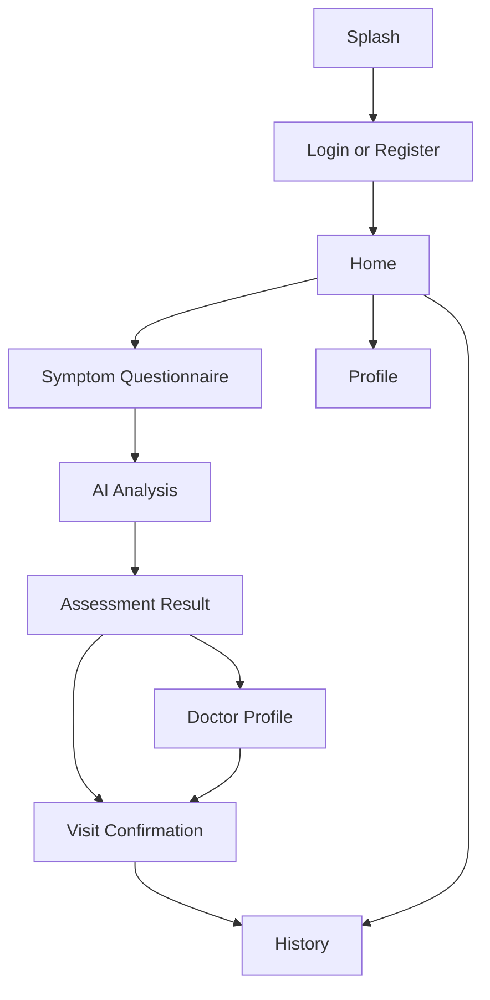
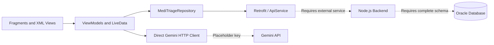

# MediTriage

**An Android prototype exploring AI-assisted symptom assessment and specialist discovery.**

MediTriage brings a guided symptom questionnaire, AI-generated assessment, doctor lookup, and visit history into one mobile experience. Built with Kotlin and Android XML views, the project explores how a mobile client can connect generative AI with structured healthcare workflows and a relational database.

> **Project status:** Educational prototype. The Android source is available for review, but the backend and complete database migrations are not included. A successful build and end-to-end execution have not yet been verified.
>
> **Intended use:** Demonstration with synthetic data only. MediTriage is not clinically validated and must not be used for diagnosis, treatment, or emergency decisions.

## Features

The Android source includes the following screens and integration logic. Network-dependent features require the missing services described below.

| Feature | Implementation |
| --- | --- |
| Patient onboarding | Registration, login, profile, and logout screens |
| Guided symptom intake | Seven questions covering fever, breathing difficulty, pain, dizziness, nausea/vomiting, bleeding, and duration |
| AI assessment | Gemini request logic and a result screen for generated severity, possible condition, advice, confidence text, and recommended specialty |
| Specialist discovery | Backend lookup by specialty and a doctor profile screen |
| Visit follow-up | Visit confirmation and actual-diagnosis entry flows |
| Patient history | Screens and API calls for reviewing previous sessions |
| Data persistence | Client contracts for sessions, symptoms, diagnoses, history, and audit records |

AI-generated confidence text is not a calibrated probability or a validated measure of medical accuracy.

## Application flow



## Architecture

The client uses ViewModels and LiveData to coordinate screen state, a repository layer for application API calls, and Retrofit for HTTP requests.



The current AI call lives in `AnalyzingViewModel.kt`, separate from the repository's backend calls. Moving this integration to an authenticated server is a planned security improvement.

### Technology stack

| Area | Technology |
| --- | --- |
| Language | Kotlin |
| User interface | Android XML layouts, Material Components, ViewBinding |
| Navigation | Android Navigation Component |
| Screen state | ViewModel and LiveData |
| Asynchronous work | Kotlin coroutines |
| Networking | Retrofit, OkHttp, Gson |
| AI integration | Gemini HTTP API |
| Intended backend | Node.js REST API — not included |
| Intended database | Oracle — partial schema example included |
| Build tooling | Gradle Kotlin DSL and version catalog |

## Repository structure

```text
MediTriage/
├── app/
│   ├── build.gradle.kts
│   └── src/
│       ├── main/
│       │   ├── AndroidManifest.xml
│       │   ├── java/com/example/meditriage/
│       │   │   ├── ApiClient.kt
│       │   │   ├── ApiService.kt
│       │   │   ├── MediTriageRepository.kt
│       │   │   ├── AnalyzingViewModel.kt
│       │   │   ├── TriageSession.kt
│       │   │   └── … fragments, view models, and data models
│       │   └── res/                 # Layouts, navigation, themes, icons
│       ├── debug/res/xml/           # Debug network policy
│       ├── test/                    # Example unit test
│       └── androidTest/             # Example instrumented test
├── docs/
│   ├── database.md                  # Database setup notes and limitations
│   └── sample_schema.sql            # Historical partial schema
├── gradle/
│   ├── libs.versions.toml
│   └── wrapper/
│       └── gradle-wrapper.properties
├── build.gradle.kts
├── settings.gradle.kts
├── gradle.properties
├── gradlew / gradlew.bat
└── SECURITY.md
```

## Getting started

### 1. Clone the repository

```sh
git clone https://github.com/amrrageh1/MediTriage.git
cd MediTriage
```

Open the repository root in Android Studio.

### 2. Prepare the Android build environment

The checked-in configuration specifies:

| Setting | Value |
| --- | --- |
| Minimum Android SDK | 26 — Android 8.0 |
| Compile SDK | 35 |
| Target SDK | 35 |
| Android Gradle Plugin | 9.1.1 |
| Gradle distribution | 9.3.1 |
| Java/Kotlin bytecode target | 11 |

These values describe the source configuration, not a verified compatibility matrix. Use an Android Studio and build JDK compatible with the configured Android Gradle Plugin. The bytecode target does not specify which JDK should run Gradle.

**Build prerequisite still missing:** `gradle/wrapper/gradle-wrapper.jar` was absent from the original archive. Restore or regenerate the wrapper using a trusted Gradle 9.3.1 installation before running the commands below. Verify the wrapper's provenance and retain the distribution checksum in `gradle-wrapper.properties`.

Configure your Android SDK locally. Keep `local.properties` out of version control.

### 3. Configure the backend URL

The default URL is the Android emulator's route to a service on the host computer:

```text
http://10.0.2.2:3000/
```

For another backend, supply the non-secret Gradle property `MEDITRIAGE_API_BASE_URL`:

```sh
./gradlew :app:assembleDebug \
  -PMEDITRIAGE_API_BASE_URL=https://your-backend.example/
```

Replace the example URL with your own endpoint. The URL must end in `/` and must not contain credentials, query parameters, or a fragment.

- **Debug builds:** Cleartext HTTP is permitted only for `10.0.2.2`, `localhost`, and `127.0.0.1`.
- **Release builds:** Cleartext HTTP is blocked. Supply a reachable HTTPS backend URL.
- **Physical devices:** Use a reachable HTTPS endpoint; the emulator host address does not apply to a physical phone.

### 4. Restore the backend and database

The Node.js server and dependency manifest are not part of this repository. The client contract is defined in [`ApiService.kt`](app/src/main/java/com/example/meditriage/ApiService.kt).

| Method | Route | Purpose |
| --- | --- | --- |
| `POST` | `patient` | Register a patient |
| `POST` | `patient/login` | Patient login |
| `POST` | `session` | Create a session |
| `PATCH` | `session/{id}/complete` | Complete a session |
| `POST` | `session/{id}/symptoms` | Save questionnaire answers |
| `POST` | `diagnosis` | Save an assessment |
| `GET` | `history/{patientId}` | Retrieve patient history |
| `POST` | `history` | Save visit follow-up |
| `POST` | `audit` | Save an audit event |
| `GET` | `doctors/specialty/{specialty}` | Find doctors by specialty |

The example SQL is **not a complete application migration**: its columns do not fully match the client payloads, and some tables and ID-generation requirements are missing. See [`docs/database.md`](docs/database.md) before attempting database setup.

### 5. Configure AI through a secure backend

The checked-in Gemini key is a placeholder, so AI requests cannot succeed as shipped. Do not replace it with a production credential in Android source or `BuildConfig`; credentials packaged in an APK can be extracted.

To enable the integration safely, move model requests to an authenticated backend, store the key on the server, select a supported model, and validate responses before returning them to the app.

## Build and validation

After restoring the wrapper and resolving toolchain/dependency compatibility, run:

```sh
# macOS / Linux: browser uploads do not preserve executable permissions
chmod +x gradlew

./gradlew :app:assembleDebug
./gradlew :app:testDebugUnitTest
./gradlew :app:lintDebug
```

On Windows, use `gradlew.bat` instead of `./gradlew`. To run instrumented tests with an emulator or device connected:

```sh
./gradlew :app:connectedDebugAndroidTest
```

The included tests are Android starter examples. They do not validate the application's triage behavior, API integration, authorization, or clinical correctness.

## Current limitations and next steps

- [x] Publish browsable Android source, resources, and example tests.
- [x] Replace the hardcoded laptop address with configurable backend settings.
- [x] Restrict HTTP access and remove credentials from current SQL files.
- [x] Verify the migrated files before removing the obsolete project ZIP.
- [ ] Restore the missing Gradle wrapper JAR and verify a reproducible build.
- [ ] Add the Node.js backend, dependency manifest, and configuration example.
- [ ] Supply complete Oracle migrations and synthetic seed data.
- [ ] Move Gemini requests behind authenticated server endpoints.
- [ ] Implement and verify backend authentication and patient-level authorization.
- [ ] Improve AI response validation, failure handling, and session persistence.
- [ ] Add meaningful unit, integration, and UI tests.

## Security and data handling

Use synthetic data while developing and demonstrating the project. Review logging, backups, data retention, access control, and AI processing before considering real patient information.

A database password was present in historical SQL files. **Rotate that password wherever it was used.** Removing it from the current branch does not remove it from previous commits, downloaded copies, or forks.

Read [`SECURITY.md`](SECURITY.md) for the project's security status and reporting guidance. Do not include credentials or patient information in public issues.

## Contributing

Focused improvements to build reproducibility, backend contracts, tests, accessibility, and error handling are welcome. Describe the problem, explain the change, and include the checks you performed. Use synthetic fixtures and keep secrets out of source control.
